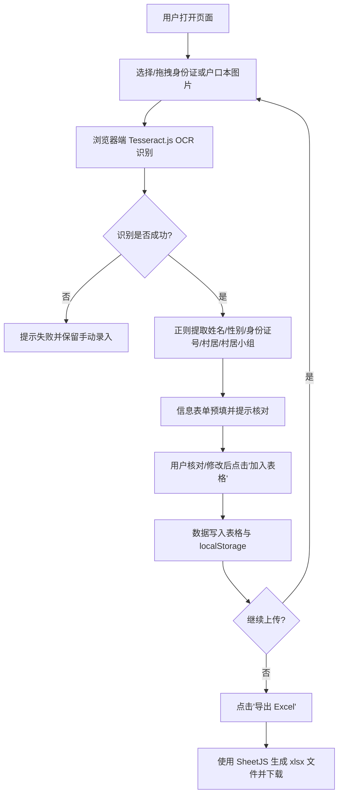

# 身份证 / 户口本信息提取工具 PRD

## 1. 产品概述

本工具是一款纯前端网页应用，面向村居社区工作人员、户籍协管员及信息登记志愿者。用户上传身份证或户口本图片后，系统自动通过浏览器端 OCR 识别图片中的关键文字，并将结果结构化展示为表格，支持手动修正、批量管理以及一键导出 Excel。  
目标价值：将传统手抄 + Excel 录入的"两小时"工作量，压缩到"上传—核对—导出"的数分钟内，且全程数据不出本地浏览器，规避敏感身份信息外传风险。

## 2. 核心功能

### 2.1 用户角色
本工具为单角色内部工具，无需注册登录，所有数据仅保存在浏览器 `localStorage` 与用户主动导出的 Excel 文件中。

### 2.2 功能模块
1. **首页 / 工作台**：单页面集成全部功能区，分为"上传与识别"、"录入表格"、"数据操作"三块。
2. **上传与识别模块**：支持点击 / 拖拽上传 JPG、PNG、WEBP 图片，实时显示识别进度条，识别完成后在表单中预填字段。
3. **录入表格模块**：以可编辑表格形式展示已采集的人员记录，支持行内编辑、删除、单条添加。
4. **数据操作模块**：提供"导出 Excel"、"清空全部"、"从本地 JSON 恢复"等批量操作。

### 2.3 页面详情
| 页面名称 | 模块名称 | 功能描述 |
|----------|----------|----------|
| 工作台 | 上传卡片 | 拖拽 / 点击上传，缩略图预览，OCR 进度条 |
| 工作台 | 信息表单 | 识别结果回填，字段：姓名、村居、村居小组、性别、身份证号 |
| 工作台 | 录入表格 | 列表展示，列头排序，行内编辑，单行删除 |
| 工作台 | 操作工具栏 | 导出 Excel、清空、统计数量 |

## 3. 核心流程

## 4. 用户界面设计

### 4.1 设计风格
- **主色**：墨青 `#0F766E`（沉稳可信的政务感）
- **辅色**：米杏 `#F5F1E8`（背景纸感）+ 朱砂 `#DC2626`（关键操作 / 危险按钮）
- **中性色**：石板灰 `#1F2937`、`#475569`、`#94A3B8`
- **字体**：标题 `Noto Serif SC`，正文 `Noto Sans SC`，数字与英文 `JetBrains Mono`（等宽，方便核对身份证号）
- **按钮**：圆角 `8px`，主操作实色 + 阴影，危险操作用朱砂描边
- **布局**：顶部品牌条 + 中部左右分栏（左：上传 + 表单；右：表格 + 工具栏），桌面优先，向下兼容到 1024px
- **图标**：使用 `lucide-react` 线性图标；不使用 emoji
- **动效**：识别进度条使用平滑的 `width transition`；表格新增行使用轻微 `translateY` 淡入

### 4.2 页面设计概述
| 页面名称 | 模块名称 | UI 元素 |
|----------|----------|---------|
| 工作台 | 顶部条 | 左侧 Logo + 标题"村居信息采集台"，右侧版本号与统计计数 |
| 工作台 | 上传卡片 | 虚线边框拖拽区，悬停高亮，上传后显示缩略图与文件名 |
| 工作台 | 信息表单 | 5 个输入字段 + "识别中…"骨架屏 + "加入表格"主按钮 |
| 工作台 | 录入表格 | 表头带排序箭头，行内编辑，悬停高亮，右上角批量操作 |
| 工作台 | 工具栏 | "导出 Excel"、"清空全部"、"JSON 备份"三按钮，水平排列 |

### 4.3 响应式
- 桌面端（≥1280px）：左右两栏等宽
- 平板（≥768px）：单栏堆叠，表格横向滚动
- 移动端：仍可使用，但提示"建议在电脑端使用以获得最佳体验"

### 4.4 3D 场景
不涉及 3D 场景。
