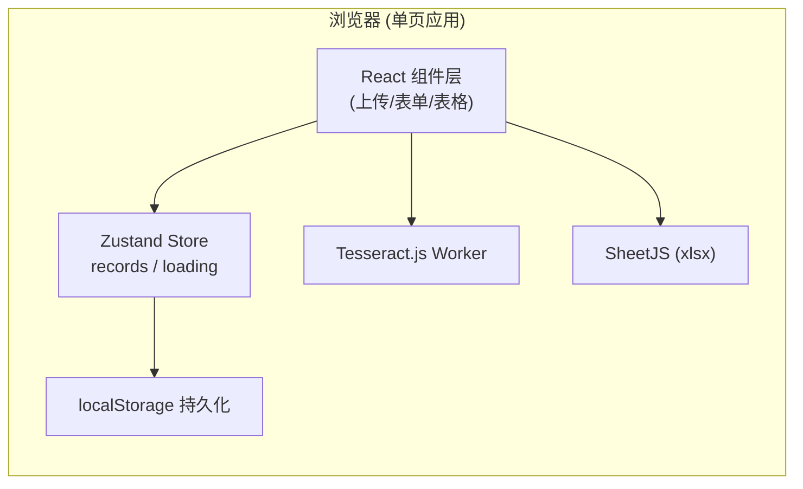
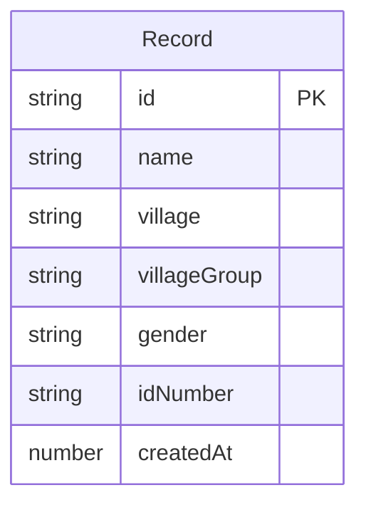

# 技术架构文档

## 1. 架构设计



纯前端单页应用，无后端服务；OCR 在浏览器 Web Worker 中执行；数据通过 `localStorage` 持久化；导出文件由 `SheetJS` 在前端生成 `.xlsx`。

## 2. 技术选型

- **构建工具**：Vite 5
- **前端框架**：React 18 + TypeScript
- **样式**：Tailwind CSS 3
- **状态管理**：Zustand
- **OCR 引擎**：Tesseract.js 5（中文简体 `chi_sim` + 英文 `eng`）
- **Excel 导出**：SheetJS (`xlsx`) 0.20+
- **图标**：lucide-react
- **后端**：无
- **数据库**：无（使用 `localStorage`）

## 3. 路由定义

单页应用，仅一条路由：

| 路由 | 用途 |
|------|------|
| `/` | 工作台（上传 / 表单 / 表格 / 导出） |

## 4. 数据模型

### 4.1 数据模型定义



### 4.2 字段说明
- `id`：`crypto.randomUUID()`
- `name`：姓名
- `village`：村居（户口本首页"住址"或身份证面"住址"中的乡镇/村居段）
- `villageGroup`：村居小组（地址中"X 组 / X 号"）
- `gender`：男 / 女（从身份证号第 17 位推断）
- `idNumber`：18 位身份证号
- `createdAt`：`Date.now()`

## 5. OCR 提取策略

1. **身份证正面**：
   - 姓名：紧贴"姓名"标签后的中文 2–4 字
   - 性别：紧贴"性别"标签后的"男/女"
   - 身份证号：18 位由数字 + 大写 X 组成的字符串
   - 村居 / 村居小组：解析"住址"标签后到下一行之间的地址字符串，按关键字"村 / 镇 / 乡 / 组 / 号"做规则切分
2. **户口本**：
   - 优先匹配"姓名"+"身份证号"+"住址"三个 anchor；性别从身份证号位次推断；村居小组通过正则提取"X 组"

## 6. 关键依赖

```json
{
  "dependencies": {
    "react": "^18.3.1",
    "react-dom": "^18.3.1",
    "zustand": "^4.5.4",
    "tesseract.js": "^5.1.1",
    "xlsx": "^0.18.5",
    "lucide-react": "^0.451.0"
  },
  "devDependencies": {
    "@types/react": "^18.3.10",
    "@types/react-dom": "^18.3.0",
    "@vitejs/plugin-react": "^4.3.1",
    "autoprefixer": "^10.4.20",
    "postcss": "^8.4.47",
    "tailwindcss": "^3.4.13",
    "typescript": "^5.5.4",
    "vite": "^5.4.8"
  }
}
```

## 7. 性能与隐私
- OCR Worker 复用，首次加载后保持常驻，避免重复下载语言包
- 用户上传的图片仅在内存中处理，不会上传到任何服务器
- 每次新增记录后增量写入 `localStorage`，刷新不丢失
